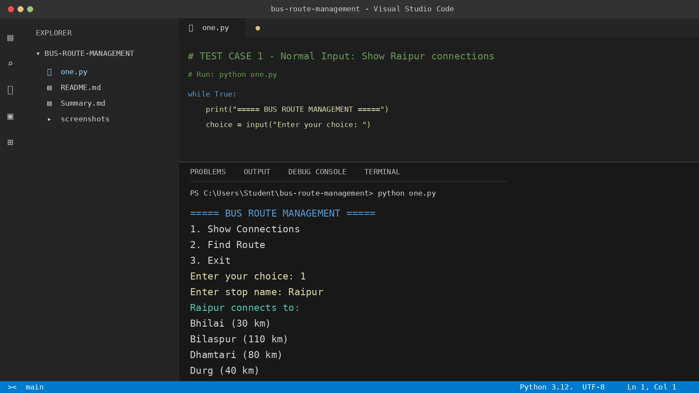
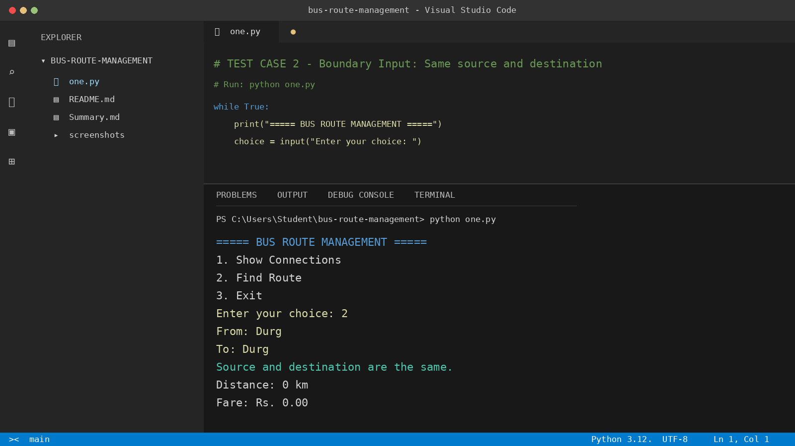

# Project Summary: Bus Route Management System

# 1. Introduction

The Bus Route Management System is a Python 3 console-based project. It stores bus stops and the distances between directly connected stops in a dictionary. The user can view the connections of a stop and find the shortest route using BFS. The project covers basic graph operations and menu-based interaction.

# 2. How the project was implemented

# Step 1: Store the bus network

A Python dictionary named `bus` stores each stop as a key. Its value is another dictionary containing the neighbouring stops and the distance to each one. Since roads work in both directions, both directions are stored in the dictionary.

# Step 2: Display connections

The `show_connections(stop)` function first checks whether the entered stop exists in the dictionary. If it exists, the function displays every directly connected stop and its distance. Otherwise, it prints a message saying the stop does not exist.

# Step 3: Find a route using BFS

The `find_route(start, end)` function checks the entered stop names and handles the case where the source and destination are the same. It then uses a queue to explore possible paths level by level. A `visited` list ensures each stop is not checked more than once.

# Step 4: Calculate distance and fare

After finding the route, the program adds the distance of each road in that route. The fare is calculated at Rs. 1.50 per kilometre:

`Fare = Total Distance x 1.50`

The fare is displayed up to two decimal places.

# Step 5: Create the menu

A `while` loop keeps the program running until the user selects Exit. The menu provides three options: Show Connections, Find Route, and Exit.

# 3. Difficulties faced and how they were handled

1. **Representing two-way roads:** Each road had to be available from both connected stops. This was handled by storing both directions in the dictionary.
2. **Finding the route with the fewest stops:** Checking only a direct connection would not work for journeys with multiple roads. BFS was used to explore routes level by level.
3. **Avoiding repeated visits:** A stop could be reached from more than one path. The `visited` list prevents it from being added to the queue repeatedly.
4. **Handling disconnected stops:** Jagdalpur and Kondagaon are separate from the other bus stops. The program displays a no-route message when the destination cannot be reached.
5. **Handling invalid and boundary inputs:** The program checks unknown stop names and handles the case where the starting and ending stops are the same.
6. **Calculating the fare correctly:** The program first adds the distances on the selected route and then multiplies the total by Rs. 1.50.

# 4. Test case screenshots

The following screenshots show the program's console output for the four assignment test cases.

## Test Case 1: Normal input - Show Raipur connections



## Test Case 2: Boundary input - Durg to Durg



## Test Case 3: Invalid / unavailable input

This screenshot includes both checks: Durg to Jagdalpur (no route) and Delhi (stop not found).


## Test Case 4: Different valid scenario - Bhilai to Bilaspur


# 5. Result

The program successfully performs the required menu operations and covers all four assignment test cases. It displays direct connections, finds a route with the fewest stops using BFS, calculates the total journey distance, and computes the fare correctly.

# 6. How to execute

Open a terminal in the project folder and run:

```bash
python one.py
```

Select the required menu option and enter the stop names when prompted.
